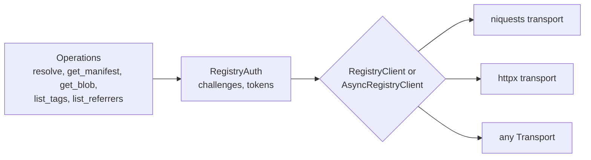

# OCI Client

`src/updates2mqtt/oci` is a read-only client for the
[OCI distribution API](https://github.com/opencontainers/distribution-spec/blob/main/spec.md),
as served by Docker Hub, GHCR, Quay, GitLab, Harbor and other registries. It's kept self-contained
so it can be published as a separate library.

## Boundary

- Nothing in `oci` imports from the rest of `updates2mqtt`
- The core modules use only the Python standard library
- Each HTTP library is imported only by its own transport, in `oci/transports`

`tests/oci/test_boundary.py` checks these rules for every module in the package, so a stray
import fails the build rather than quietly coupling the two.

## Design



Each operation is a generator that yields `HttpRequest` and receives `HttpResponse`, with no I/O of
its own. The auth flow wraps it the same way, answering `401` challenges. So the protocol logic is
written once, and `RegistryClient` and `AsyncRegistryClient` just send each request over their
transport. A transport is anything with `send(HttpRequest) -> HttpResponse`, following redirects.

| Module | Contents |
| ------ | -------- |
| `reference.py` | `Reference`, parsing image references as Docker does, e.g. `nginx` is `docker.io/library/nginx` |
| `http.py` | `HttpRequest`, `HttpResponse`, `Headers`, and the `Transport` protocols |
| `auth.py` | `WWW-Authenticate` parsing, the token flow, and credential stores |
| `client.py` | The operations, and the sync and async clients |
| `models.py` | `Manifest`, `Descriptor`, `Platform`, `Blob`, `ResolvedImage` |
| `errors.py` | `OCIError` and subclasses, e.g. `RateLimitedError` with `retry_after` |
| `transports/` | niquests and httpx transports, sync and async |

### Authentication

- Follows each registry's `WWW-Authenticate` challenge, bearer token or basic auth, with
  parameters in any order
- Tokens are cached for their `expires_in` lifetime, and once a host has challenged, later
  requests fetch a token first, saving a round trip
- Credentials come from a `CredentialStore`:
    - `DockerConfigCredentials` reads `docker login`'s config file, including `credHelpers`,
      `credsStore`, identity tokens (exchanged with an OAuth2 refresh token grant) and registry tokens
    - `StaticCredentials` and `ChainedCredentials` for anything else
- A token passed to an operation is sent as is, falling back to the challenge flow if rejected

### Caching

Caching is left to the HTTP layer. Every `HttpRequest` says what it is, in `kind` (`manifest`,
`blob`, `tags`, `referrers` or `token`) and `immutable` (fetched by digest). Each transport takes a
`prepare(request, kwargs)` hook to adjust the arguments passed to its HTTP library.

Updates2MQTT's `CachingRegistryTransport` uses this with httpx and Hishel, setting cache lifetimes
from the `registry` config. A caching niquests session could be used the same way.

## Usage

```python
from updates2mqtt.oci import DockerConfigCredentials, RegistryClient

with RegistryClient(credentials=DockerConfigCredentials()) as client:
    image = client.resolve("ghcr.io/rhizomatics/updates2mqtt:latest", "linux/amd64")
    print(image.digest, image.labels.get("org.opencontainers.image.version"))
    print(client.list_tags("ghcr.io/rhizomatics/updates2mqtt")[-5:])
```

```python
from updates2mqtt.oci import AsyncRegistryClient

async with AsyncRegistryClient() as client:
    image = await client.resolve("nginx:latest", "linux/arm64")
```

Without a transport, the client uses niquests if it's installed, otherwise httpx. To use a
particular HTTP client, e.g. one with caching, pass a transport:

```python
from updates2mqtt.oci.transports.niquests_transport import NiquestsTransport

client = RegistryClient(NiquestsTransport(my_session))
```

The same calls are available from the command line, for example
`u2m-cli referrers=ghcr.io/rhizomatics/updates2mqtt:latest`.

## Testing

`tests/oci/fake_registry.py` is an in-memory registry with token auth, pagination and the
referrers API. It's served in process for most tests, and over real HTTP on localhost to test
each transport, sync and async.
