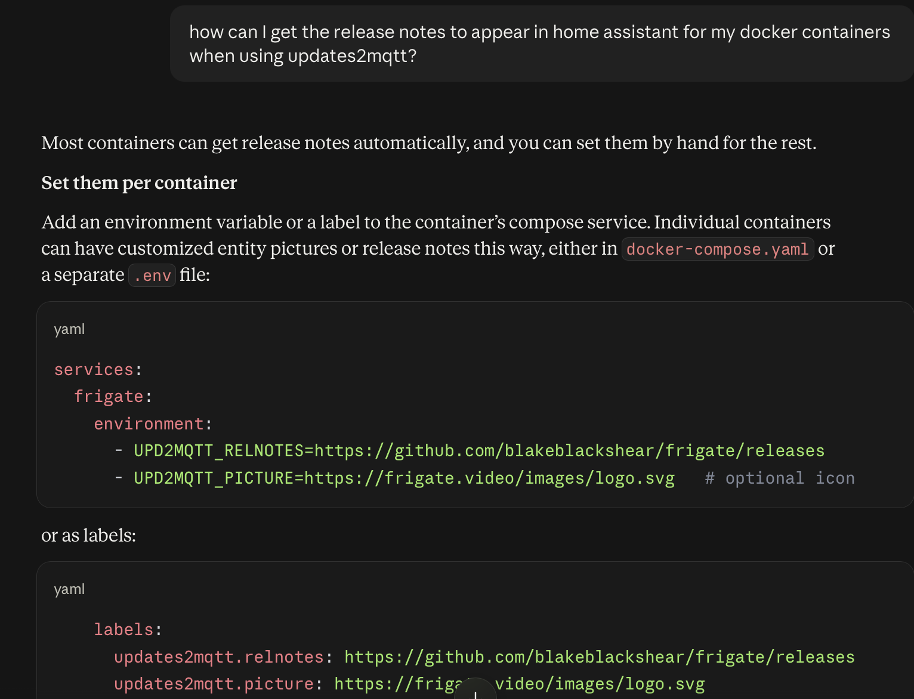
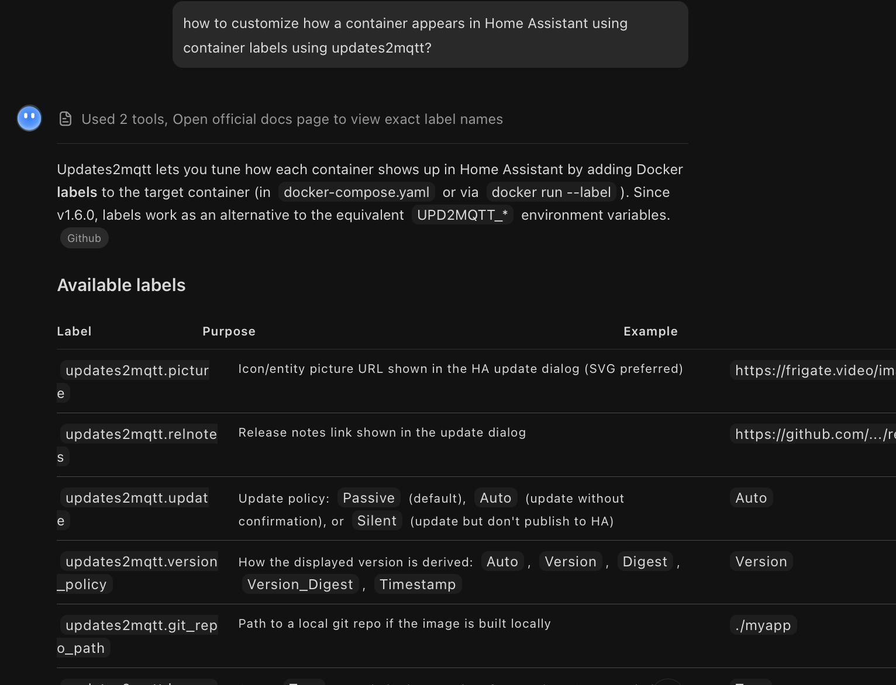

---
tags:
  - ai
  - claude
  - chatgpt
  - kimi
  - agent
  - google
  - support
  - help
title: Google and AI Assisted Help
description: Using Google and AI agents for help with Updates2MQTT
---
# Google and AI Assisted Help

AI agents, like Claude or ChatGPT, are becoming increasingly better at giving good advice on Updates2MQTT, helped by the documentation being setup to be accessible to them, including an [llms.txt](https://updates2mqtt.rhizomatics.org.uk/llms.txt) summary.

They can diagnose issues from logs, suggest how to configure Home Assistant or a container the way you want, and write or rewrite the `config.yaml`, `docker-compose.yaml` or container labels.

In all the examples below there is no special setup, no skills or other context - they are given a simple prompt as might be the case for a new user.

## Google Example

Searching in Google for "how to get updates2mqtt to update home assistant every hour" should turn up advice on changing the `scan_interval`, as explained in the [FAQs](faqs.md#scanning).

Not all searches in Google result in AI advice, and you might have this switched off, however you should still get pointed directly at the right page in the on-line Updates2MQTT help.

## Claude Example

Claude can work through a `docker logs updates2mqtt` output to diagnose MQTT connection or Docker access problems, and suggest config fixes.

## ChatGPT Example

ChatGPT can suggest workable `docker-compose.yaml` snippets for running Updates2MQTT, including the volume mappings needed for compose directories.

## Kimi Example

A free [Kimi](https://kimi.ai) agent can explain how to customize how a container appears in Home Assistant using container labels.

## Advanced Agent Usage

If you have a desktop or coding agent, such as Claude Code, then running it on the Docker host where Updates2MQTT runs lets it read logs, inspect containers and run the [Docker CLI](troubleshooting.md#docker-cli) tools directly.

- `u2m-cli mqtt=check` will show the settings in use and test the broker connection, see [Checking MQTT and Update Settings](troubleshooting.md#checking-mqtt-and-update-settings)
- Caution is due where passwords, API keys and other secrets in `config.yaml`, `.env` or compose files could be exposed to the agent.
